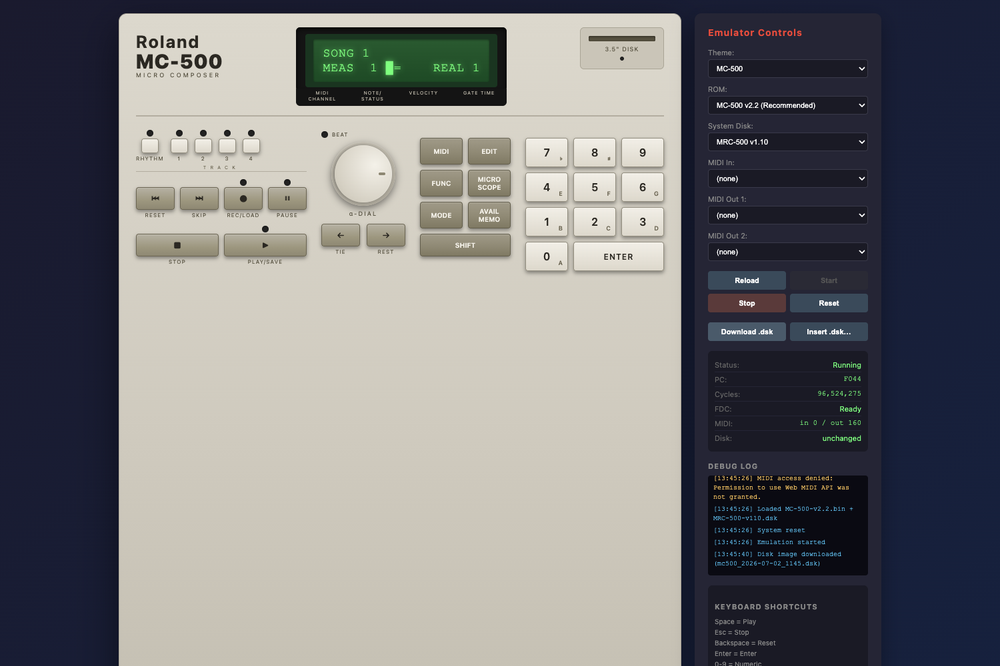
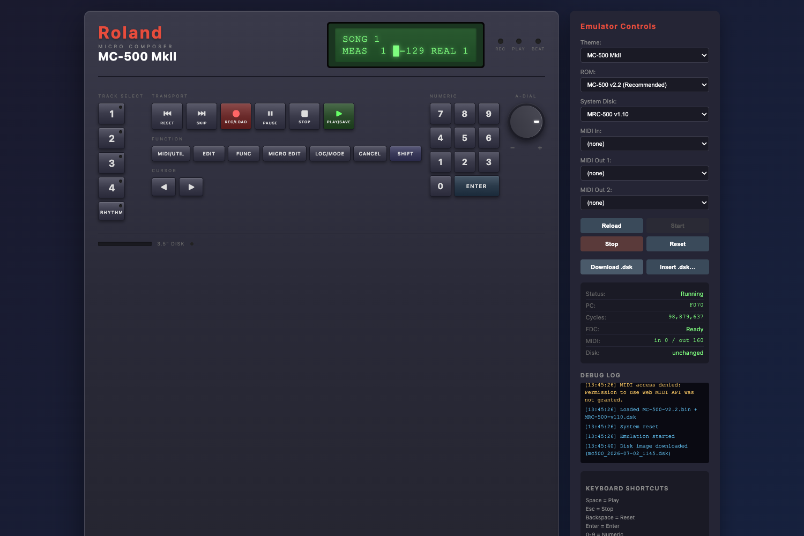

# Roland MC-500 MicroComposer Emulator

A web-based emulator for the **Roland MC-500 / MC-500 MkII MicroComposer**
(1986), the classic hardware MIDI sequencer. It runs the original firmware and
system software on an emulated HD64180 CPU — the real MRC-500 recorder boots,
records, plays back, and saves to disk, just like the hardware.

| MC-500 theme | MC-500 MkII theme |
|---|---|
|  |  |

## Features

- **Full boot of the original firmware** — boot ROM + MRC-500 system disk,
  no ROM patches
- **Working front panel** — every key of the matrix verified against the
  firmware (see [emulator/KEY_MATRIX.md](emulator/KEY_MATRIX.md)), panel LEDs
  driven by the real LED latch, and the α-dial with firmware-accurate pulse
  timing (including its acceleration behavior)
- **Web MIDI in/out** — record from a real MIDI keyboard and play back to
  hardware or soft synths (Chrome/Edge; both MIDI OUT ports emulated)
- **Disk save/load** — the firmware's Mode 2 SAVE writes to the emulated
  floppy; download the `.dsk` image to keep your songs, re-insert it later
- **Two panel themes** — original MC-500 and MC-500 MkII (both run the same
  system software, like the real machines)

## What's emulated

| Component | Notes |
|---|---|
| Hitachi HD64180 (Z180) CPU | Instruction set, MMU, PRT timers, ASCI (MIDI), CSI/O, DMA, vectored interrupts |
| Gate array | Key matrix (0xC0-0xC3), LED latch, α-dial pulse lines, disk change/control |
| WD1772 FDC | Read/write sector, seek, DMA-serviced data transfers, 720K raw images |
| HD44780 LCD | 2×20 character display incl. CGRAM custom glyphs and display shift |
| MIDI | IN via ASCI0 at wire speed, OUT1/OUT2 |

## Getting started

ROM and disk images are copyrighted by Roland and **not included** — dump them
from your own hardware. See [emulator/roms/README.md](emulator/roms/README.md)
and [emulator/disks/README.md](emulator/disks/README.md) for the expected
filenames.

```sh
./run.sh
# open http://localhost:8500
```

**Live demo:** https://markldn.github.io/mc500-emulator/ — the page can't ship
the ROMs, so click **Load ROM…** and pick your own 8 KB boot ROM dump (and
**Insert .dsk…** for a system disk). Nothing is uploaded anywhere; the files
stay in your browser.

The emulator auto-loads the MC-500 v2.2 ROM + MRC-500 v1.10 disk and boots to
the `SONG 1` standby screen in a few seconds.

## Using it

It behaves like the real machine, so the
[MRC-500 owner's manual](https://archive.org/details/manuals-roland) applies.
Quick reference:

- **Record**: REC/LOAD → ENTER (accept 4/4) → ENTER → "Press PLAY Button!" →
  PLAY → two-bar count-in → play your MIDI keyboard → STOP
- **Save**: MODE → 2 → ENTER → 2 (SAVE) → ENTER → ENTER → name with the
  α-dial and → cursor → ENTER → "Sure?" → PLAY/SAVE.
  Then click **Download .dsk** in the side panel to keep the disk image.
- **Load**: insert a `.dsk` (side panel) → MODE → 2 → ENTER → 1 (LOAD) →
  ENTER → select song → ENTER → REC/LOAD
- **Dial**: mouse wheel or drag on the dial, or ↑/↓ keys
- **Keyboard**: Space = Play, Esc = Stop, Backspace = Reset, Enter, 0-9, ←/→

## Development

The live core is four files in `emulator/js/`:

| File | Role |
|---|---|
| `z180.js` | HD64180/Z180 CPU core |
| `mc500.js` | Machine model: memory map, gate array, LCD, keys, dial, MIDI |
| `wd1772.js` | Floppy disk controller |
| `main-hd64180.js` | Web UI |

Tests (need Node.js; ROM + disk images in place):

```sh
cd emulator
node dial-test.mjs      # α-dial step accuracy against the firmware
node disk-test.mjs      # record → SAVE to disk → reboot → LOAD round-trip
node browser-test.mjs   # headless-Chrome UI test (buttons, dial, LEDs, themes, disk UI)
```

`KEY_MATRIX.md` documents the reverse-engineered key matrix, LED latch and
dial protocol, and how they were derived by probing the firmware.

## Legal

This project is not affiliated with or endorsed by Roland Corporation.
"Roland", "MC-500" and "MicroComposer" are trademarks of Roland Corporation,
used here only to describe the emulated hardware. Firmware ROMs and system
disk software remain the property of Roland and are not distributed.

Emulator code is released under the [MIT license](LICENSE).
